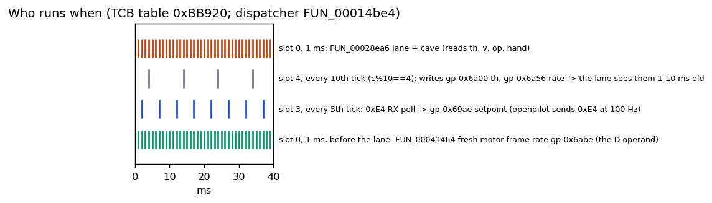
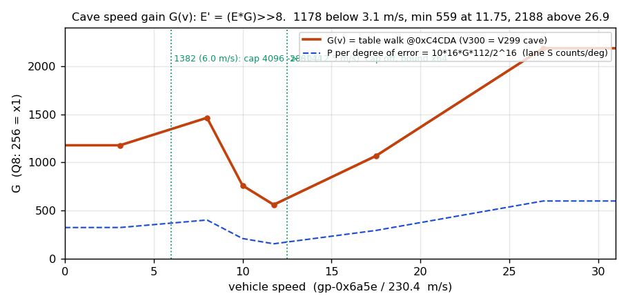
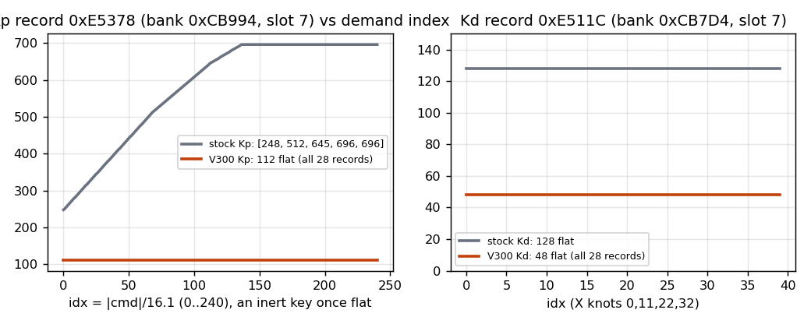
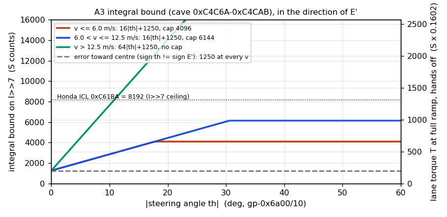
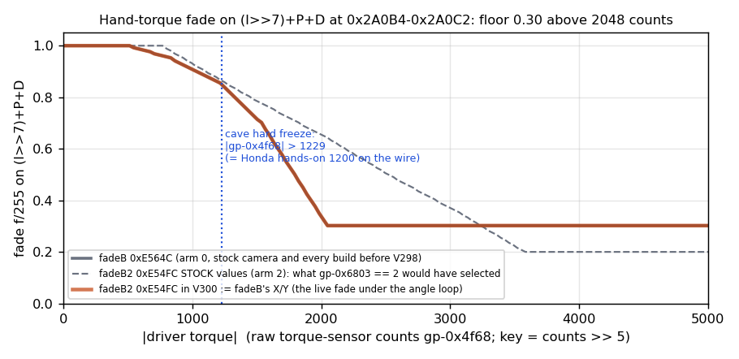
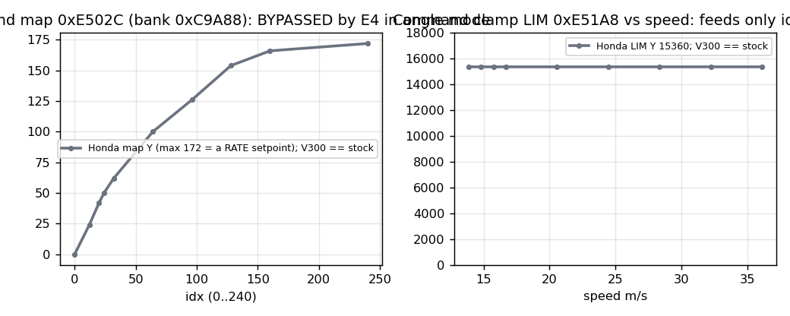
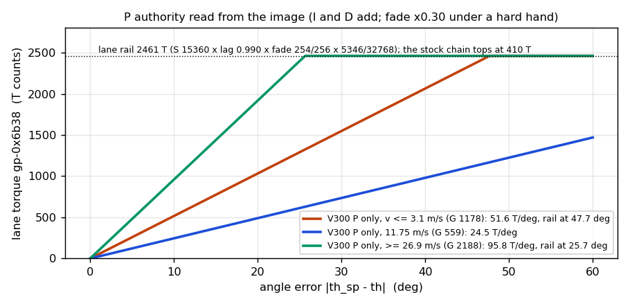
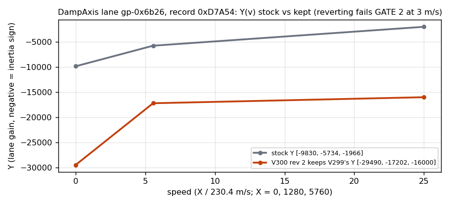

# FIRMWARE CODE PATH — 2020 Honda Accord EPS `39990-TVA-A160` (Renesas V850E2), stock and the angle-loop RELEASE (V300, id `A16C`)

Written 2026-10-15 for the release close-out (second pass, re-read against the release image). Reference images, both under
`../accord-firmwares/analysis-2020accord/`: **stock** `stock_fw_dump/code.bin` (sha256 `3f1d55a9…`) and **V300**
`_v300_V300-REV2-RELEASE-ANGLELOOP.FROMSTOCK-KP112.KD48.KI40.ICL8192-FRZ1229.CAP4096.6144-NOTELEMETRY.NOMAP.STOCKASSIST.DAMPAXIS.V299.A16C_plain_image.bin`
(sha256 `7d58c823544e9e6ec369e7cc0fc0d7aa42fc8b075ad9b0005f58973d400f384e`; rwd sha256 `42f562c0…`). V300 rev 2 is built from stock: **766 bytes differ in
`[0x13000, 0x100000)`, in 207 runs and 8 CRC blocks (main, 0xC6, 0xD7, 0xE4–0xE8)** (E, exact byte compare this pass); 2,110 bytes vs V299. V299 differed from stock by **2,471 bytes**
(E, same compare; the first draft of this document said 2,825 because its run merger counted the single matching byte between two
differing bytes as part of the run, 354 such bytes — a counting defect, not a byte one). The 260-B cave at `0xC4C00` is byte-identical
in V299 and V300 rev 2 (sha `e22193b9…`); the loop tuning is unchanged from V299. Rev 2 differs from rev 1 only by keeping the DampAxis lane at V299's values (13 bytes, GATE 2 re-score). Every address below was read from those bytes in Python, and
every decision-bearing instruction was decoded by GhidraMCP on the stock program (`disassemble_bytes dry_run`, `decompile_function`) or
is quoted from a trace that did so (cited). Tags: **E** = evidence with the method, **B** = belief. Figures:
`analysis-2020accord/figures/codepath/` (`make_codepath_figures.py`, ~1 s, reads stock and V300).

Companion documents: the release build report (`analysis-2020accord/studies/release/BUILD-V300-REPORT.md`), the byte census it was built
from (`docs/review/RELEASE-CENSUS-V299-vs-STOCK-2026-10-15.md`), the lineage
(`docs/BUILD-LINEAGE*.md`), the design (`docs/specs/design/DESIGN-ANGLE-LOOP-C3-rev2-2026-10-01.md`,
`docs/specs/design/v299/DESIGN-V299-SYNTHESIS-rev3-2026-10-02.md`), the golden model (`analysis-2020accord/model/eps_chain_*.py`).

---

## 0. Reading guide

| term | meaning |
|---|---|
| `gp`, `tp` | V850 global/text pointers: `gp = 0xFEDF8000` (RAM), `tp = 0xBF000` (flash). `gp-0x6a00` is RAM `0xFEDF1600`; `tp+0x73E6` is flash `0xC63E6`. The main cal block is `0xC6000–0xC6FFF` = `tp+0x7000…`. |
| record / bank | A LERP record is `n:u16, X[n]:u16, Y[n]:u16` (layout from `0x29DDE sld.hu 0x2,ep` and `0x29DE2 add 0xc` — **E**). A bank is a table of 28 record pointers, one per variant slot; **the live slot is 7** (measured on the wire, `TVCA4`). Slot-7 records live in the `0xE5000` page. |
| S, T | S = the PID sum before the output stages (`(I>>7)+P+D`, clamp ±15360). T = lane torque at `gp-0x6b38` (clamp ±3072). At full ramp, hands off, `T ≈ 0.1602·S`; the rail is **2461 T** (**E**, arithmetic in §1.4.8). |
| E, E′ | E = the PID error (`sp<<2 − r26` in stock, `16·(θ_sp−θ)` under the mod). E′ = `(E·G(v))>>8`, the cave's speed-scaled error that Honda's P and I actually consume. |
| θ, v, op, hand | θ = `gp-0x6a00`, s16, **0.1° per count**, +10× openpilot's angle. v = `gp-0x6a5e`, u16, **230.4 counts per m/s** (64/km/h). op = `gp-0x6abe`, s16, the fresh motor-frame rate (0x7FFF when invalid). hand = `gp-0x4f60` (signed) / `gp-0x4f68` (magnitude), raw torque-sensor counts; the 0x1AB wire value is raw×1.024, so Honda's 1200-count hands-on level is raw 1229. |
| tasks | RTOS slots from the TCB table `0xBB920` (dispatcher `FUN_00014be4`): **slot 0** every 1 ms tick (priority 6, highest) runs the lane; **slot 3** every 5th tick (200 Hz) polls CAN RX; **slot 4** every 10th tick (100 Hz) writes θ and the wire rate. Switching is cooperative at checkpoints — slot 3 cannot preempt slot 0 (**E**, `TRACE-2026-09-30-dominance-preemption-…`). |



**One picture of the whole chain (★ = touched by the mod; everything else is byte-stock in V300):**

```mermaid
flowchart LR
  OP[openpilot 0xE4 @100 Hz<br/>bytes0-1 raw s16, byte2 b7 request, b3:2 field] -->|slot 3 poll| RX[FUN_00052676 RX cb<br/>gp-0x69ae = clamp(-4·raw,±16384)<br/>gp-0x6805 = req, gp-0x6803 = field]
  RX --> SM[engage SM in FUN_00028ea6<br/>ST gp-0x6807, state, ramp gp-0x69b0]
  SM --> GUARD[guard 0x29A48 ★A2/B2<br/>run iff ramp≠0 ∧ req ∧ inputs valid]
  SENS[θ gp-0x6a00 (100 Hz hold) ★E1<br/>op gp-0x6abe (1 kHz)<br/>v gp-0x6a5e, hand gp-0x4f60/68] --> FB[fb filter 0x28F4C–0x28FBC<br/>r26 = 8θ[n]+8θ[n-1] ★cals a,b,C]
  GUARD --> SP[setpoint 0x29032–0x29D6C<br/>★E4: sp := gp-0x69ae<br/>(stock: idx → map Y)]
  SP --> HOOK[★HOOK 0x29D76 jarl 0xC4C00]
  FB --> HOOK
  HOOK --> CAVE[★CAVE 0xC4C00 (260 B)<br/>E = 4sp − r26; op-skip; E′ = E·G(v)>>8;<br/>camera gate; 1229 freeze; A3 bound; caps]
  CAVE --> PID[Honda PID 0x29D7A–0x29F24<br/>I: Ki 40, ICL 8192 · P: Kp 112 · D: Kd 48 on op ★OPH]
  PID --> FADE[hand fade 0x29F08–0x2A0C2<br/>f = A(grab)·B(|hand|) ≥ 0.30 ★record 0xE54FC]
  FADE --> OUT[epilogue 0x2A174–0x2A23C<br/>SCL 15360 → lag 5 Hz → sign-hold gate → ×ramp → ×pol×5346>>15 ★0x2A1F0 → ±3072 ★]
  OUT --> T[gp-0x6b38 lane T → gp-0x6b3c]
  T --> ARB[FUN_0002b422 ±0xC61B2 ★ → FUN_00025c32 → FUN_00026c80 → gp-0x6b4c]
  ARB --> AGG[FUN_0003aa2c aggregator<br/>+ base assist, damper, friction, return-centre → gp-0x6b94]
  AGG --> GOV[governor → EME shaper → gp-0x6b98]
  GOV --> FOC[FOC FUN_00071272 → PWM → motor]
```

## The V300 release, at a glance

**(a) Delta read from the V300 rev-2 image** (E, exact byte compare this pass; 766 bytes vs stock in 207 runs, 8 CRC blocks; 2,110 bytes vs V299).

| V300 vs STOCK — every run, grouped | bytes | what it is | E/B |
|---|---|---|---|
| `0x28F4E` E1 · `0x29A50` B2 · `0x29A56` A2 · `0x29D6A` E4 · `0x29D76` HOOK · `0x29EE0` OPH · `0x2A1F0` GAIN | 20 | the in-place lane edits (§2.1) | E |
| `0xC4C00–0xC4D03` | 260 | the cave: op-skip, G(v), camera gate, 1229 freeze, A3 bound, caps (§2.2) | E |
| `0xC63E6..EB` Ki 40 / a 0 / b 8192 · `0xC62E4..E7` DB 0 / C 65535 · `0xC61BB` ICL 8192 | 11 | the loop's cal cells (§2.4) | E |
| `0xC6CD0` 5346 · `0xC61B3`/`B5` clamps 3072 | 4 | the 6× authority chain | E |
| `0xC659A…0xC65CE` (f32) · `0xC674F…0xC676E` (s16) | 21 | the EME corridor/floor ladder, int + float pairs | E |
| `0xC61C0..C5` · `0xC64B4..B8` | 11 | STEER_STATUS debounce + DTC-0x49 gate (V36/V37 package) | E |
| `0xC62EA` 0 | 2 | low-speed lockout off | E |
| `0xD7A5C..61`, `0xD7A6C..71` Y = −29490/−17202/−16000 · `0xC40DC` α2 = 14 | 13 | the DampAxis lane (`gp-0x6b26`, a lagged positive-inertia term on the motor rate) kept at V299's values — GATE 2 (§4) | E |
| Kp Y on 28 records (`0xE43xx`, `0xE53xx`, `0xE63xx`, `0xE73xx`, `0xE82xx`) · Kd Y on 28 (`0xE41xx`…`0xE80xx`) | 280 + 112 | 112 flat / 48 flat on every slot | E |
| `0xE54FE..0xE5515` | 22 | fadeB2 (arm 2) := fadeB's X/Y | E |
| `0x1310D` `C` · `0x13109` `,` | 2 | F181 `39990-TVA,A16C` | E |
| 8 CRC trailers (`0xC4FFC`, `0xC6FFC`, `0xD7FFC`, `0xE4FFC`…`0xE8FFC`) | 32 | recomputed | E |

| V300 vs V299 — removed (stock again) | what it was |
|---|---|
| telemetry: hook `0x55C0E`, cave `0xC4B34` (164 B), 0x1AB packer `0x55DF2–0x55E13` | 0x14A byte-4 bits 3–7 and byte-7 bits 6–7 rungs, and the torque tap |
| ×6 assist map (28 records) · LIM 16384 (28 records) | the rate-setpoint map and ceiling, bypassed by E4 |
| r24 gate `0x3AA96` + arm `0xC6446` 2048 | the aggregator's torque-rate lane switched to STEER_CONTROL_ACTIVE |
| biquad arm `0xC649B` + `0x35A08/12/18` · Coulomb relay `0xC40BC/D2` · square-wave hold `0xC64DE` | base-assist levers from the grinding era |
| damper banks `0xCE000–0xD9FFF` (979 of 992 B) | per-slot base-assist rate/boost/friction records — all but the 13 DampAxis bytes |
| `0x454FE` · `0x14120` | an inert selector byte; the dead id-string copy |
| Kp/Kd on the 27 non-selected records | 960 / 0 in V299 → 112 / 48 in V300 (slot 7 unchanged) |

**(b) Risk, before the drive**

| item | statement | E/B |
|---|---|---|
| lane authority | the rail stays **2461 T**: 15360 × 0.990 × 254/256 = 15090, × 5346 ≫ 15 = 2461 — **6.0× Honda's 410 T** (891, under a 512 clamp). Unchanged since V282; the angle loop's P/I/D were sized on it | E |
| STEER_STATUS / DTC | the V36/V37 package keeps Honda's driver-torque-transient STEER_STATUS trip and the DTC-0x49 over-torque counter **OFF**, as on every flown build since V37 (stock `0xC64B4..B8` = 112/96/54/64/112) | E (bytes; side-channel lens: no live reader where 255 disables a protection the loop relies on) |
| EME protection | Honda's excessive-motor-effort (soft-EME) protection is **≈ 5× looser in ALL driving**, engaged or not: the corridor/floor ladder 1024 → 5120 (`0xC674E…`, a kept ×6 cell). Permissive only; the V38…V267 configuration that flew with Honda's banks | E (bytes), B (headroom: 5120 sits below governor ceiling + comp 5325 + 2560) |
| stock camera | with a stock camera the lane is **inert** (field ≠ 2 → E′ = 0): V300 is base assist only, not stock Honda LKAS | E |
| request drop | **no ramp-out**: A2 skips the PID on the first request-0 tick, so lane torque goes to 0 at once (through the 5 Hz lag), instead of Honda's 0.5 s ramp-out | E |
| hands-on feel | base-assist damper banks (except DampAxis), Coulomb relay and biquad are stock again: the manual feel returns to Honda's after ≈ 6 weeks on the modified banks | E (bytes), **B** (magnitude) |
| wire | 0x14A byte 4 bits 3–7 and byte 7 bits 6–7 are no longer forced by a cave; nothing on the wire identifies the build except F181 | E (bytes), B (power-on value 0) |
| engaged r24 lane | returns to Honda's speed LERP (V299 ran a flat 2048) — a plant-damping shift inside the loop | E (bytes); GATE 2 re-score **filled (E, `analysis-2020accord/studies/release/GATE2-RESCORE-STOCK-PLANT-TERMS.md`):** reverting the r24 gate/arm passes (ΔPM −0.7…+0.1°, GM ≥ 20 dB, 5–30 Hz peak ≤ −4 dB, L20 ≤ 1.01× V295). Reverting the DampAxis lane FAILED (GM at 3 m/s 20 → 5.2 dB, closed-loop peak 5–30 Hz +5.4 dB, Ms 1.26 → 2.68), so rev 2 KEEPS it at V299's values (13 bytes: Y rows `0xD7A5C..61`, `0xD7A6C..71` = −29490/−17202/−16000 and α2 `0xC40DC` = 14); the knee/K1 relay and the rest of the damper banks are not loop terms |
| low speed | lockout `0xC62EA` = 0: the loop is live below 5 km/h | E |
| hand fade | the direction-2 arm record `0xE54FC` carries arm 0's curve (floor 0.30 above 2048 counts); the 1229 freeze is Honda's hands-on level | E |

**(c) Fork side (one box).** The angle-loop EPS is detected from fw id `39990-TVA,A16?`; 0xE4 carries `raw = −10·θ_des` with byte-2 bits 3:2 = 2 on every frame; the fork runs the standard angle limiter and then its error clip; under angle control there is **no turn-initiation lead** — the measured cause of the high-angle back-and-forth (`docs/scoring/DRIVE-READ-V299-latest-routes-2026-10-15.md`: "Verdict: FORK-SOURCED — the setpoint itself moves back and forth, and the wheel follows it"). Firmware tuning is unchanged from V299.

---

## 1. The path, stage by stage

### 1.1 CAN 0xE4 reception — `FUN_00052676` (slot 3, 200 Hz poll) — **E** (decompiled this pass)

The RX dispatcher `FUN_000521dc` walks 19 message descriptors at `0xBB544`; index 7 is 0xE4. A new frame goes through checksum
(`FUN_000541d8`) and counter (`FUN_0005413a`) and then `FUN_00052676(status)`; no frame for 500 ms (cal `0xC626C`) calls it with the
timeout status instead (**E**, `TRACE-2026-09-30-dominance-preemption-…` §2–3).

```python
def rx_0xE4(status, b0, b1, b2, b3, coding=gp_6400):            # FUN_00052676, V300 = stock bytes
    if status == 4 and gp_3330 == 1:    sentinel(); return      # 0x5268C: fault 4 after a good frame
    if status in (1,2,3,5,6,7):         sentinel(); FUN_0005462c(7, status); return   # 0x52726 (DTC 0x65, no fault-class bit)
    if coding & 8:                      sentinel(); ...         # 0x527C6: coding bit 3 — 0 on this car (row 11)
    raw = s16((b0 << 8) | b1)                                   # FUN_00021724: STEER_TORQUE, big-endian s16
    gp_69ae = clamp(-4 * raw, -0x4000, 0x4000)                  # FUN_00049a90(raw*-4, -0x4000, 0x4000); st.h @0x526F2
    gp_6803 = (b2 << 28) >> 30   # byte 2 bits 3:2 (logical shr: 0x526F6 '429e' = shr 0x1e)  — THE CAMERA-INTERLOCK FIELD
    gp_6804 = (b2 << 25) >> 31   # byte 2 bit 6
    gp_6805 = b2 >> 7            # byte 2 bit 7  = STEER_TORQUE_REQUEST
    gp_6802 = b2 & 3             # byte 2 bits 1:0
    gp_67f3 = b3 >> 7 if not (gp_6802 == 1 and ctr < 500) else 0xFF   # byte 3 bit 7 with a 500-call debounce
def sentinel():                                                 # the 0xE4 fault / timeout value set
    gp_69ae = 0x7FFF; gp_6805 = gp_6804 = gp_6803 = gp_6802 = gp_6876 = gp_67f3 = 0xFF
```

- Under the mod `raw` **is an angle setpoint**: `θ_sp = −raw` in 0.1° counts (the fork sends `raw = −10·θ_des`), range ±4096 counts = ±409.6°.
- The sentinel `0x7FFF` arrives **510–514 ms** after the last frame and is re-asserted every 5 ms; until then the last setpoint and
  request are **held** (**E**, timeout mirror in the same trace). `gp-0x6805 = 0xFF` ≠ 1 fails the request test, and the sentinel fails
  the lane's `(gp-0x69ae + 0x4000) < 0x8001` validity term, so under A2/B2 (§2.1) the PID does **not** run on a sentinel. On stock and
  on V293–V295 it did: `sp = +1032` railed P for the 2.048 s ramp-down (**E**, `TRACE-2026-09-30-sentinel-downstream…` §3).
- The stock camera sends bits 3:2 ∈ {0, 1} on 6.9 M frames and never 2; openpilot sent 0 until the V298 fork change (**E**,
  `TRACE-2026-10-01-camera-0xE4-byte2-census.md`). The mod runs the lane only when the field is 2 (§2.3).

### 1.2 Engagement state machine (inside `FUN_00028ea6`, `0x2912C–0x2973x`) — **E** (traces 2026-09-30, Ghidra listing)

| cell | role |
|---|---|
| `gp-0x6807` ST | lane status: 3 = invalid inputs / `bVar2` false (0xE4 sentinel lands here), 4 = release, 6 = coding hold (unreachable, coding bit 3 = 0), 7 = sticky fault (`FUN_00046ea6(9)`, `gp-0x67fa == 8`, inputs invalid) |
| `bVar2` → r27 | `gp-0x69aa ∈ [0xC73F2, 0x8000] ∧ speed window ∧ gp-0x67fe == 2 ∧ (gp-0x69ae + 0x4000) <u 0x8001` — computed at `0x2912C–0x2913A`, **dominates** the guard at `0x29A50` (**E**, CFG script in the dominance trace) |
| state | 1 idle → 3 ramp-in (request 1, `gp-0x6803` 0 or 2, ST < 3) → 2 saturated → 4 ramp-out → 1; 5 = fast fault ramp |
| ramp `gp-0x69b0` | Q15, 0…0x8000. Per-tick steps are per **arm** of `gp-0x6803`: arm 0 in `0xC63F8` = 33 (0.99 s), out `0xC63F6` = 16 (2.05 s); **arm 2 in `0xC63FC` = 328 (0.10 s), out `0xC63FA` = 66 (0.50 s)**; fault `0xC63F4` = 328 |
| `gp-0x6806` | 1 while engaged, 0 on release — arms the sign-hold gate (§1.4.8) and selects r24/r26 lane gains in the aggregator |

Because the fork now sends field 2 every frame, the **arm-2 ramps are the live ones**: engage 0.10 s, release 0.50 s (**E**, cal cells
read; cal values byte-stock).

### 1.3 Sensor side — what the lane reads — **E** (`TRACE-2026-09-30-angle-signal-gp6a00.md`, `TRACE-2026-10-02-fresh-rate-D-sign-and-pol.md`)

| cell | producer / rate | formation (integer, from the bytes) | unit, range |
|---|---|---|---|
| `gp-0x6a00` θ | `FUN_0003e6d8` @`0x3e758`, **slot 4, 100 Hz** | `θ = gp-0x3608 + pol·C(d) + ((gp-0x69ca·128)>>7)` if `gp-0x67fe ∈ {1,2}` else 0; `d = gp-0x6cc4 − gp-0x69d0` motor counts; `C(x) = sign(x)·LERP((|x|·45)>>9; X 0xC6892, Y 0xC68A2)` the variable-ratio correction (0 → +4.3° over the first 27.7°) | s16, 0.1°/count; the 0x14A wire carries −θ; openpilot angle = −0.1·wire = +0.1·θ |
| `gp-0x69ca` | `FUN_0003bd7c`, slot 0, 1 kHz | linear angle = base + pol·lin(d); gain 1/1.155 of θ near centre | 0.1° (uncorrected) |
| `gp-0x6abe` op | `FUN_00041464` @`0x22200`, slot 0, **before the lane** | EMA (α = 37/128, `0xC643C`) of the resolver rate `gp-0x4f50` (`FUN_00068f52`, clamp ±13000); **0x7FFF when invalid**; carries **no** pol | motor-frame counts; `sign(op) = pol·sign(dθ/dt)` |
| `gp-0x6a56` | `FUN_0003f776`, slot 4, 100 Hz | `pol·((op·48·1159)>>15)`, clamp ±12000, valid iff `op+13000 <u 26001` | 8 counts per deg/s; the stock PID's feedback operand; the 0x18F wire = −gp-0x6a56 |
| `gp-0x4f60` / `gp-0x4f68` | torque-sensor pipeline, slot 0 | signed / magnitude driver torque | raw counts; wire = raw × 1.024 |
| `gp-0x6752` pol | parsed from a config record below 0x13000, re-asserted every slot-3 pass by `FUN_000497e6` | **−1 on this car** (V98/V99 run-time read, 30 k frames; byte-identical parser in V299) | ±1 |
| `gp-0x6a5e` v | speed voter, 10 ms | — | u16, 230.4 counts per m/s |

Consequences that matter to the loop: θ reaches the 1 kHz lane **1–10 ms old** (a 100 Hz sample-and-hold, ≈ 4° of phase at 2 Hz,
40° at 20 Hz); op is fresh every tick; θ snaps to **0** whenever `gp-0x67fe ≠ 2` (assist substate drop) — measured never in 2.3 M
healthy frames, but a cave gate on it is not present (declared, §4).

### 1.4 The LKAS lane `FUN_00028ea6` (`0x28EA6–0x2A30E`, slot 0, called from `0x22522`)

#### 1.4.1 Feedback-operand filter `0x28F4C–0x28FC6` — runs every valid tick, above the guard — **E** (listing in the hook trace; bytes re-read)

```python
# stock                                         # V300 (★ = changed)
x = ld_h(gp-0x6a56)        # 0x28F4C rate       x = ld_h(gp-0x6a00)              # ★E1: hw2 aa95→0096 — x := θ
if abs(x) > 12000: bail(r26=0, gp_3d2c=2)        # 0x28F50–0x28F5A  (±1200° on θ: never)
s_old = ld_w(gp-0x3d30)                          # 0x28F7C (0 on the first tick after a bail)
b = ld_hu(0xC63EA); a = ld_h(0xC63E8); C = ld_hu(0xC62E6)   # stock 1560 / 923 / 7680 → ★ 8192 / 0 / 65535
s_new = ((b*x) >> 10) + ((a*s_old) >> 10)        # 0x28F8E–0x28FA2: two separate floors
r26 = s_old + s_new                              # 0x28FA4 add r9,r26  (c9d1) — stock AND V300; V294/V295 had subr
st_w(gp-0x3d30, s_new); r26 = clamp(r26, ±C)     # 0x28FA8, 0x28FAC–0x28FBC
```
Stock: a one-pole LPF (16.5 Hz) on the wire rate, DC gain `2b/(1024−a) = 30.89`. V300: a = 0, b = 8192 ⇒ `s_new = 8θ` exactly, so
**`r26 = 8θ[n] + 8θ[n−1] = 16θ`** with a half-sample average and no pole; C = 65535 bounds |θ| at 409.6° (**E**, MIRROR 20 000 pairs).

#### 1.4.2 The guard `0x29A48–0x29A64` — **E** (Ghidra dry-run this pass, stock; V300 bytes read)

```
stock                                          V300
29a48 cmp r0,r14 ; setfne r20   r20 = ramp≠0   same
29a4e cmp 1,r8   ; setfe r8     r8 = (req==1)  29a50 ★B2 e2470000→e0df3443  cmovne r0,r27,r8 : r8 = req? bVar2 : 0
29a54 cmp r0,r20 ; 29a56 bne 29a60             29a56 ★A2 da05→b205  be 29a5c
29a58 cmp r0,r8  ; 29a5a bne 29a60             29a58 cmp r0,r8 ; 29a5a bne 29a60 ; 29a5c jr 2a164
29a5c jr 2a164   (SKIP)
29a60 cmp r0,r25 ; bne 29a68 ; 29a64 jr 2a164  (SKIP iff inputs invalid)
```
Stock runs the PID iff `ramp ≠ 0 ∨ request`; V300 runs it iff **`ramp ≠ 0 ∧ request == 1 ∧ bVar2`**. That removes two stock
behaviours: integrating at ramp 0 while the request bit is still 1 (the override-latch wind-up), and the 0xE4 sentinel pulse
(`bVar2` is false on 0x7FFF). r27 holds `bVar2` on every path to `0x29A50` and r8 is dead after the guard (**E**, dominance trace §1).
The compares at `0x29A4E`/`0x29A54`/`0x29A58` are untouched: B2 is 4 bytes at `0x29A50`, A2 one byte at `0x29A56`.

#### 1.4.3 The setpoint stage `0x28FC8–0x29D6C` — stock computes a RATE setpoint from an 8-bit index — **E** (hook trace §1, bytes re-read)

```python
cmd  = ld_h(gp-0x69ae)                                   # 0x29032
LIM  = LERP(rec(0xCB844[7] = 0xE51A8), v)                # 0x28FC8–0x29036: Y 15360 flat (stock = V300)
r22  = clamp(cmd, ±LIM)                                  # 0x2903A–0x29044
taper = LERP(same-sign 0xCB924 / opposite 0xCB8B4 (arm 0) or the cliff arms 0xCBA74/0xCBA04 (arm 2), key gp-0x682f)
G0   = (spF · taper) & 0xFFFF                            # 0x29CB4; spF = LERP(0xC6974, gp-0x6830) = 255 ⇒ 65025 hands off
vv   = (G0 · r22) >> 16 ; if gp-0x682f > [0xC64B8]: vv = 0   # 0x29CBC–0x29CC0, 0x29A86 (cal 255 in V300: never)
vv >>= 6 ; sign = -1 if vv < 0 else 1                     # 0x29CD6, 0x29CD4/D8
idx  = min(abs(vv), 240)                                  # 0x29CDC–0x29CFA, clamp cells 0xC64F0/F1
st_b(gp-0x674b, idx)                                      # 0x29D14 (telemetry byte)
Y    = LERP(rec(0xC9A88[7] = 0xE502C), idx)               # 0x29D18–0x29D68: Y 0…172 (stock = V300; V282…V299 carried a ×6 line to 1032)
sp   = sign · Y                                           # 0x29D6A mov r8,r16 ; 0x29D6C mulh r13,r16  ← ★E4 replaces BOTH with ld.h -0x69ae[gp],r16
st_h(gp-0x6a32, sp)                                       # 0x29D72 (zero live readers)
E    = (sp << 5) - r26                                    # 0x29D76 shl 0x5 ; 0x29D78 sub r26,r16   ← ★HOOK replaces both with jarl 0xC4C00,r6
```
One idx step is 16.13 wire counts; stock's map therefore turns a torque-shaped command into a **rate** reference (max 172 ≈ 21 deg/s
against the 30.89-gain rate feedback). Under the mod `sp = gp-0x69ae = −4·raw` directly, so `4·sp = 16·θ_sp` matches `r26 = 16·θ`
and the map, LIM, taper, the 240 clamp and the `0xC64B8` zeroing are all **bypassed** for the setpoint; idx is still formed and keys
Kp/Kd, which are flat in V300, so it is inert (**E**). The release carries **Honda's own map and LIM** (the ×6 line of V282–V299 is gone).
`gp-0x682f` is **not** a map output: it is the driver bar torque `min(|gp-0x4f60| >> 5, 255)` (`0x29068 st.b r8,-0x682f`; side-channel lens, E), so reverting the map changes none of the fade/arb keys.

#### 1.4.4 Integral `0x29D7A–0x29DC4` — **E** (Ghidra dry-run this pass)

```python
e5  = E >> 5                                        # 0x29D7A mov r16,r6 ; 0x29D7C sar 0x5   (E = E′ under the mod)
DB  = ld_hu(0xC62E4)                                # 0x29D6E: stock 4, ★V300 0
exc = e5-DB if e5 > DB else (e5+DB if e5 < -DB else 0)   # 0x29D7E–0x29D9A
Ki  = ld_hu(0xC63E6)                                # 0x29D9C: stock 0 (!), ★V300 40
ICL = (ld_hu(0xC61BA) << 10) >> 3                   # 0x29DA0/AC/AE: stock 10240 → 1,310,720; ★V300 8192 → 1,048,576
I   = clamp((ld_w(gp-0x6dd0) >> 3) + ((exc*Ki) >> 3), ±ICL)   # 0x29DA4–0x29DC4; the cell holds 8·I (st.w r24 @0x2A190)
```
The I contributes `I >> 7` to S, so ICL 8192 caps that contribution at **8192 S** (53 % of the 15360 rail). **Honda ships Ki = 0**;
the integral exists in stock but never acts.

#### 1.4.5 Proportional `0x29DC6–0x29E5C` — **E** (listing)

`Kp = LERP(rec(0xCB994[7] = 0xE5378), idx)` (`0x29DC6 mov 0xcb994,r10`; walk at `0x29DDE–0x29E32`), then
`P = clamp((E·Kp) >> 8, ±0xC61BC = 15360)` (`0x29E34 mov r16,r8 ; 0x29E36 mul r9,r8 ; 0x29E3E sar 0x8`). Stock Kp Y = 248, 512, 645,
696, 696 at X = 0, 68, 112, 136, 208; **V300 Y = 112 flat on all 28 records** (fig 2). Under the mod E is E′, so `P = (E′·112)>>8`.

#### 1.4.6 Derivative `0x29E5E–0x29F06` — **E** (Ghidra dry-run this pass, stock; V300 bytes read)

```
stock                                                     V300
29e5e ld.w -0x6cf8,r8 … 29e7e cmovnc r16,r8,r27            same: r27 = E_prev (if |E_prev| ≤ 768000) else E   — now unused by D
29e76–29edc Kd = LERP(rec(0xCB7D4[7]=0xE511C), idx)        same; stock Y 128 flat → ★V300 48 flat (all 28 records)
29ede zxh r7                                               same (Kd zero-extended ⇒ no cal-only sign flip exists)
29ee0 mov r16,r8 ; 29ee2 sub r27,r8    dE = E − E_prev     ★OPH 1040bb41→1a400000  mov r26,r8 ; nop   : D operand := r26 = op (the cave left it there)
29ee4 mul r7,r8 ; 29eec sar 0x3        D = (Kd·dE)>>3      D = (48·op)>>3 = 6·op
29ee8–29f06 clamp ±0xC61B6                                 10240 (stock = V300; V282…V295 had 0)
```
Stock D is on the **error difference**; the mod's D is on the **fresh motor-frame rate** with no pol factor, so `D = 6·op` enters S
with `+` (`0x29F24 add r8,r2`) and the whole S is multiplied by pol at the output ⇒ on this car (pol = −1) **D opposes wheel motion**
(**E**, `TRACE-2026-10-02-fresh-rate-D-sign-and-pol.md`; route-79 estimators agree). A pol of +1 would invert D alone.

#### 1.4.7 Sum, hand fade, sum clamp `0x29F08–0x2A162` — **E** (hook trace §2/§4; records read from both images)

```python
S  = (I >> 7) + P + D                                    # 0x29F18 sar 0x7,r2 ; 0x29F1E add r9,r2 ; 0x29F24 add r8,r2
A  = LERP(rec(0xCBB54[7]=0xE55A4) if r25 else rec(0xCBC34[7]=0xE56F4), gp-0x6830)   # grab-rate axis; both X 0,3,6,8,10,20 Y 255×5,205
B  = LERP(rec(0xCBAE4[7]=0xE54FC) if r25 else rec(0xCBBC4[7]=0xE564C), gp-0x682f)   # |hand|>>5 axis — THE OVERRIDE FADE
f  = ((A*B) & 0xFFFF) >> 8                               # 0x2A0B4–0x2A0BC: 254 hands off, floor 76 (0.297)
S  = clamp((S*f) >> 8, ±0xC61BE = 15360)                 # 0x2A0BE–0x2A0C2, 0x2A13E–0x2A162
```
`r25 = (gp-0x6803 == 2)` (`setfe r25 @0x29A82`, its only writer; live across the hook, callee-saved). Under the mod r25 = 1 always, so the
**arm-2 records are live**. V298 copied fadeB's X/Y into the arm-2 record `0xE54FC` (stock arm 2 faded 1.8–2.1× harder mid-range) and V300 keeps that, so
the live fade is the one every flown build had: X = 16, 26, 38, 48, 64, 96 (×32 raw counts), Y = 255, 243, 218, 179, 77, 77 (fig 4). The I
accumulator is **not** bled by the fade — that is what the cave's 1229 freeze and A3 bound are for.

#### 1.4.8 Epilogue `0x2A164–0x2A23C`: skip path, output lag, sign-hold gate, ramp, gain, rail — **E** (Ghidra dry-run this pass)

```python
# SKIP entry (A2/B2 skips, op-skip): 0x2A164 mov 0,r24 ; mov 0,r29 ; mov 0,r27 ; mov 0,r22 ; mov 0x7fffffff,r16 ; mov 0,r12
#   ⇒ S := 0 into the lag, 8·I := 0 (st.w r24,-0x6dd0 @0x2A190), E_prev := 0x7FFFFFFF (st.w r16,-0x6cf8 @0x2A18C), gp-0x6b2e/32/34/36 := 0
s   = ld_w(gp-0x3d3c)                                            # 0x2A178 lag state
s2  = ((992 * s) >> 10) + ((507 * S) >> 10)                      # 0x2A174 ld.hu 0xC63EE=507 ; 0x2A184 ld.h 0xC63EC=992 ; 0x2A1A0/A6/A8
y   = (s + s2) >> 5 ; st_w(gp-0x3d3c, s2)                        # 0x2A1AA/AC/B0: one-pole 5.05 Hz, DC 2·507/32/32 = 0.990
if ld_bu(0xC64A3) == 1 and gp-0x6806 == 0:                       # 0x2A198, 0x2A1B6: sign-hold gate, armed while released
    if abs(y) <= ld_h(0xC61B8)=102 or y * ld_h(gp-0x6b30) <= 0:  y = 0   # 0x2A1BE–0x2A1E2: never push against the last delivered sign
y   = sxh((y * ramp) >> 15)                                      # 0x2A1E6–0x2A1EC: × gp-0x69b0 (Q15)
k   = ld_h(0xC646C=891)  # stock ; ★V300 (since V87): 0x2A1F0 hw2 6c74→d07c reads 0xC6CD0 = 5346 (stock cell value 0xFFFF)
T   = (pol * k * (y + gp-0x6b2c)) >> 15 ; T = clamp(T, ±ld_hu(0xC61B4))   # 0x2A1F2–0x2A220; gp-0x6b2c addend == 0; clamp 512 stock, ★3072
st_h(gp-0x6b38, T)                                               # 0x2A23C
gp-0x6b3c = T if gp-0x67a4 in {2,3} else 0                       # 0x2A2EA (tail)
```
**Rail arithmetic (E):** S 15360 × 0.990 × 254/256 = 15090 → × 5346 >> 15 = **2461 T** (stock: × 891 >> 15 = 410 T, under its 512 clamp).
The lane's gain is therefore **6.0× stock** (5346/891) with the two clamps `0xC61B4`/`0xC61B2` raised 512 → 3072 to match (`5346·512/891 = 3072`
exactly). This is the "6×" authority chain; the release keeps it because the angle loop's P/I/D were sized on it (fig 6).

### 1.5 Downstream of the lane — carried from the golden model (`[VERIFIED]` tags there; not re-decompiled this pass)

| stage | function | what it does to the LKAS value |
|---|---|---|
| limit/pack | `FUN_0002b422` | clamp ±`0xC61B2` (stock 512, ★3072); the enable FSM `gp-0x67a4` is produced here from `gp-0x67a1/a2/a3/a7` |
| DampAxis lane ★ | `FUN_00041464` → `FUN_00036c12` → `gp-0x6b26` | `x = gp-0x4f50` (motor rate) → EMA α 37/128 → `d = Δ` → `yA += ((32d − yA)·K2) >> 6` (K2 = `0xC40DC`, ★14, stock 22) → `g = yA >> 9` → `lane = clamp(((g·Y(v)) >> 6)·0x111 >> 18, ±511)`, Y(v) = record `0xD7A54` X 0/1280/5760 Y ★−29490/−17202/−16000 (stock −9830/−5734/−1966): a lagged positive-inertia term summed into `gp-0x6b94` without pol (E, re-score §1) |
| r24 lane | in `FUN_0003aa2c` | `pol · deadband(G(v) · gp-0x4f62, 3)`, `gp-0x4f62 = 0.5·(T_raw[n] − T_raw[n−4])` — the driver-torque-derivative lane; G(v) = Honda's 3.00/2.50/2.25/2.10 speed LERP again in V300 (E, re-score §1) |
| distribute | `FUN_00025c32` | per-lane clamps; LKAS rides ±0x2800 |
| mixer | `FUN_00026c80` | sums the LKAS-internal sources → `gp-0x6b4c` (final clamp ±0x2800) |
| gate | `FUN_00042ac6` | `|x| ≤ 0x2800 ? x : 0x7FFF` → `gp-0x6afe` |
| aggregator | `FUN_0003aa2c` (`0x3aa2c–0x3ad70`) | `gp-0x6b94 = Σ` LKAS `gp-0x6b4c` + base assist `gp-0x6bbe` + damping `gp-0x6bd0` + friction `gp-0x6b26` + return-centre `gp-0x6b62` + magnitude `gp-0x6b86` + resonance `gp-0x6ad4` + the r24/r26 torque-rate lane — all **byte-stock in V300** (V299's r24 gate repoint `0x3AA96` and arm `0xC6446` = 2048 are reverted). Every range gate here is vacuous on every build (producers cap inside their windows) |
| governor | `FUN_0004503c` / `FUN_0004595a` / `FUN_000456a4` | ceilings (`0xC6202` 4762 > 2506 LKAS max) |
| EME shaper | `FUN_00042af8` | soft-EME Q15 integrator against the corridor bounds (★corridor walls ±1.0→±5.0 and boost floor →5.0 at `0xC659A…0xC65CE` (f32) / `0xC674F…0xC676E` (s16), matched pairs for the lockstep monitor — the "EME ladder" that lets the 6× lane through without a soft-EME cut) → `gp-0x6b98` |
| lockstep | §8 of the model | int wall vs float twin (DTC 0xF00049) — the reason int and float cells are always edited as matched pairs |
| FOC | `FUN_00041464` → `FUN_00071272` | EIIC 0x600 ADC-complete → Park/Clarke → PI current regulator → SVPWM |

The 0xE4 fault-cell census showed **no consumer of the fault cells on this delivery path** — once the lane emits T, nothing downstream
knows whether 0xE4 was healthy (**E**, sentinel trace §3). Everything downstream of `gp-0x6b38` is **byte-stock** in V300 except the
arbitration clamp `0xC61B2` and the EME ladder cells; the base-assist lanes (damper banks, Coulomb relay, biquad, r24 arm) that V299 still
carried are Honda's again (§5).

---

## 2. The mod, as built in the release V300 (`39990-TVA,A16C`)

### 2.1 In-place code edits (main CRC block `[0x13000, 0xC4FFC)`) — **E**: bytes read from both images; decodes from the Ghidra dry-runs above and the build-round listings

| id | addr | stock → V300 | stock instruction → new instruction | why |
|---|---|---|---|---|
| E1 | `0x28F4E` | `aa 95` → `00 96` | `ld.h -0x6a56[gp],r7` → `ld.h -0x6a00[gp],r7` | the filter's operand becomes θ |
| B2 | `0x29A50` | `e2 47 00 00` → `e0 df 34 43` | `setfe r8` → `cmovne r0,r27,r8` | r8 = request ? bVar2 : 0 |
| A2 | `0x29A56` | `da` → `b2` | `bne 0x29A60` → `be 0x29A5C` | run only when ramp ≠ 0 **and** r8 |
| E4 | `0x29D6A` | `08 80 ed 80` → `24 87 52 96` | `mov r8,r16 ; mulh r13,r16` → `ld.h -0x69ae[gp],r16` | sp := the raw command (the map path cannot carry an angle: 1.61° steps) |
| HOOK | `0x29D76` | `c5 82 ba 81` → `89 37 8a ae` | `shl 0x5,r16 ; sub r26,r16` → `jarl 0xC4C00,r6` | enter the cave; r6 = 0x29D7A return |
| OPH | `0x29EE0` | `10 40 bb 41` → `1a 40 00 00` | `mov r16,r8 ; sub r27,r8` → `mov r26,r8 ; nop` | D operand := r26 (= op, left by the cave) |
| GAIN | `0x2A1F0` | `6c 74` → `d0 7c` | `ld.h 0x746c[tp],r7` → `ld.h 0x7cd0[tp],r7` | lane gain reads the private cell `0xC6CD0` = 5346 instead of the shared 891 (V87 class, carried since) |
| V1 | `0x1310D` | `30` → `43` | F181 string `39990-TVA,A160` → `…A16C` | the fork's firmware fingerprint (UDS F181 is the only reader). `0x13109` `-`→`,` is kept (the live string's punctuation); the dead second copy at `0x14120` is stock again |

Stock `0x28FA4` is already `add r9,r26` (`c9 d1`); V294/V295 had changed it to `subr` and V298 restored it, so **vs stock it is not an edit**.
All eight sites re-read from the V300 image this pass; the telemetry hook `0x55C0E`, the 0x1AB packer `0x55DF2–0x55E13`, `0x3AA96`, `0x454FE` and `0x14120` read **stock** (E).

### 2.2 The cave at `0xC4C00` (260 B: 218 B code + 42 B table) — instruction by instruction

Entry: `jarl 0xC4C00,r6` from `0x29D76` with **r16 = sp** (`gp-0x69ae`), **r26 = 16θ** (the filter), r25 = (`gp-0x6803` == 2), r14 = ramp,
r10 = DB, r22/r7 = idx. The cave writes **no RAM** (0 `st.*`; GATE 1 — **E**, listing + H1). V300's 260 bytes at `0xC4C00` are
byte-identical to V299's (sha `e22193b9…`, re-hashed this pass; the release H1 run `studies/release/h1_v300_built.py` matched the mirror). Exits: **DONE** `jmp [r6]` → `0x29D7A` with
r16 = E′, r26 = op; **FRZ/CAM** `jr 0x29D7E` with r6 preset (skips Honda's `mov r16,r6 ; sar 5` so `e5 := r6`); **op-skip** `jr 0x2A164`.
Decode source: GhidraMCP dry-run on the built image (`studies/angle_loop/v299_build/ghidra_listing_v299_cave.json`), bytes re-read from
the image this pass; the H1 interpreter run matched the mirror on 16 000 cases with two negative controls (**E**, `MIRROR-H1-V299.md`).

| addr | bytes | V850E2 | effect | C / Python | design term |
|---|---|---|---|---|---|
| `C4C00` | `c282` | `shl 0x2,r16` | r16 = 4·sp | `E = (sp << 2)` | E = 16·θ_sp − 16·θ |
| `C4C02` | `ba81` | `sub r26,r16` | r16 = 4sp − r26 | `E -= r26` | " |
| `C4C04` | `24d74295` | `ld.h -0x6abe[gp],r26` | r26 = op | `op = s16(gp_6abe)` | fresh motor-frame rate |
| `C4C08` | `1a46c832` | `addi 0x32c8,r26,r8` | r8 = op + 13000 | | validity window |
| `C4C0C` | `206e9065` | `movea 0x6590,r0,r13` | r13 = 26000 | | " |
| `C4C10` | `ed41` | `cmp r13,r8` | | | " |
| `C4C12` | `b305` | `bnh C4C18` | continue if (op+13000) ≤u 26000 | `if (op+13000)&0xFFFFFFFF > 26000:` | **op-skip** (Honda's own ±13000 test form) |
| `C4C14` | `b6075055` | `jr 0x2A164` | invalid rate (0x7FFF): Honda's skip epilogue — I := 0, sentinel, S := 0 | `return SKIP` | no torque path on an invalid rate |
| `C4C18` | `e447a395` | `ld.hu -0x6a5e[gp],r8` | r8 = v | `vv = gp_6a5e` | speed |
| `C4C1C` | `2906da4c0c00` | `mov 0xc4cda,r9` | r9 = &table | | G(v) table (relinked ptr) |
| `C4C22` | `e96f0100` | `ld.hu 0x0[r9],r13` | r13 = X₀ = 714 | | |
| `C4C26` | `ed41` | `cmp r13,r8` | | | |
| `C4C28` | `cb05` | `bh C4C30` | v > X₀ → walk | | |
| `C4C2A` | `e9470300` | `ld.hu 0x2[r9],r8` | G = Y₀ = 1178 | `G = rows[0].y` | below 3.1 m/s |
| `C4C2E` | `b515` | `br C4C54` | | | |
| `C4C30` | `e96f0700` | `ld.hu 0x6[r9],r13` | r13 = X_{i+1} | `while vv > rows[k+1].x: k += 1` | walk |
| `C4C34` | `ed41` | `cmp r13,r8` | | | |
| `C4C36` | `c305` | `bnh C4C3E` | v ≤ X_{i+1} → segment found | | |
| `C4C38` | `094e0600` | `addi 0x6,r9,r9` | next row | | |
| `C4C3C` | `a5fd` | `br C4C30` | | | |
| `C4C3E` | `e96f0100` | `ld.hu 0x0[r9],r13` | r13 = X_i | | |
| `C4C42` | `ad41` | `sub r13,r8` | r8 = v − X_i | | |
| `C4C44` | `296f0400` | `ld.h 0x4[r9],r13` | r13 = slope_i (signed) | | |
| `C4C48` | `ed472002` | `mul r13,r8,r0` | r8 = (v−X_i)·slope | | |
| `C4C4C` | `ac42` | `sar 0xc,r8` | >> 12 | `G = ((vv-x)*s >> 12) + y` | linear segment |
| `C4C4E` | `e96f0300` | `ld.hu 0x2[r9],r13` | r13 = Y_i | | |
| `C4C52` | `cd41` | `add r13,r8` | G | | |
| `C4C54` | `e8872002` | `mul r8,r16,r0` | r16 = E·G | `Ep = (E*G) >> 8` | **E′** |
| `C4C58` | `a882` | `sar 0x8,r16` | | | Q8 |
| `C4C5A` | `e0c9` | `cmp r0,r25` | | `if r25 == 0:` | **camera interlock** |
| `C4C5C` | `e235` | `be C4CC8` | field ≠ 2 → CAM | | |
| `C4C5E` | `e44799b0` | `ld.hu -0x4f68[gp],r8` | r8 = \|hand\| | `h = gp_4f68` | |
| `C4C62` | `206ecd04` | `movea 0x4cd,r0,r13` | 1229 | | **hard freeze level** (V298: 512) |
| `C4C66` | `ed41` | `cmp r13,r8` | | | |
| `C4C68` | `db2d` | `bh C4CC2` | \|hand\| > 1229 → FRZ | `if h > 1229: return FRZ` | hands-on: I frozen, P and D still live |
| `C4C6A` | `244f0096` | `ld.h -0x6a00[gp],r9` | r9 = θ | `r9 = theta` | **A3 bound** |
| `C4C6E` | `e081` | `cmp r0,r16` | | | |
| `C4C70` | `ae05` | `bge C4C74` | | | |
| `C4C72` | `8049` | `subr r0,r9` | if E′ < 0: r9 = −θ | `if Ep < 0: r9 = -r9` | θ·sgn(E′) |
| `C4C74` | `e049` | `cmp r0,r9` | | | |
| `C4C76` | `ae05` | `bge C4C7A` | | | |
| `C4C78` | `004a` | `mov 0x0,r9` | if r9 < 0: 0 | `r9 = max(r9, 0)` | toward centre ⇒ 0 (asymmetric) |
| `C4C7A` | `e447a395` | `ld.hu -0x6a5e[gp],r8` | r8 = v | | |
| `C4C7E` | `206e400b` | `movea 0xb40,r0,r13` | 2880 = 12.5 m/s | | |
| `C4C82` | `ed41` | `cmp r13,r8` | | | |
| `C4C84` | `9b15` | `bh C4CA6` | v > 2880 → uncapped path | | |
| `C4C86` | `c44a` | `shl 0x4,r9` | 16·r9 | `b = (r9 << 4) + 1250` | ≤ 12.5 m/s |
| `C4C88` | `094ee204` | `addi 0x4e2,r9,r9` | + 1250 | | friction allowance B |
| `C4C8C` | `206e6605` | `movea 0x566,r0,r13` | 1382 = 6.0 m/s | | **two-level cap** |
| `C4C90` | `ed41` | `cmp r13,r8` | | | |
| `C4C92` | `cb05` | `bh C4C9A` | | | |
| `C4C94` | `206e0010` | `movea 0x1000,r0,r13` | cap 4096 (v ≤ 6 m/s) | `cap = 4096 if vv <= 1382 else 6144` | |
| `C4C98` | `b505` | `br C4C9E` | | | |
| `C4C9A` | `206e0018` | `movea 0x1800,r0,r13` | cap 6144 (6 < v ≤ 12.5) | | V299's new level |
| `C4C9E` | `ed49` | `cmp r13,r9` | | | |
| `C4CA0` | `ed4f364b` | `cmovh r13,r9,r9` | r9 = min_u(b, cap) | `b = min(b, cap)` | |
| `C4CA4` | `c505` | `br C4CAC` | | | |
| `C4CA6` | `c64a` | `shl 0x6,r9` | 64·r9 | `b = (r9 << 6) + 1250` | > 12.5 m/s, no cap |
| `C4CA8` | `094ee204` | `addi 0x4e2,r9,r9` | + 1250 | | |
| `C4CAC` | `246f3192` | `ld.w -0x6dd0[gp],r13` | r13 = 8·I | `t = I8 >> 10` | I in S units (I>>7) |
| `C4CB0` | `aa6a` | `sar 0xa,r13` | | | |
| `C4CB2` | `e081` | `cmp r0,r16` | | | |
| `C4CB4` | `ae05` | `bge C4CB8` | | | |
| `C4CB6` | `8069` | `subr r0,r13` | if E′ < 0: t = −t | `if Ep < 0: t = -t` | I projected on E′'s direction |
| `C4CB8` | `e969` | `cmp r9,r13` | | | |
| `C4CBA` | `ce05` | `bge C4CC2` | t ≥ bound → FRZ | `if t >= b: return FRZ` | **winding past the bound** |
| `C4CBC` | `ce6e0080` | `andi 0x8000,r14,r13` | ramp full? | `if not ramp & 0x8000: return FRZ` | **ramp-in freeze** |
| `C4CC0` | `ca0d` | `bne C4CD8` | → DONE | | |
| `C4CC2` | `0032` | `mov 0x0,r6` | FRZ: e5 := 0 | | I unchanged this tick |
| `C4CC4` | `b607ba50` | `jr 0x29D7E` | into Honda's exc test with r6 = 0 | | P (r16 = E′) and D (r26 = op) stay live |
| `C4CC8` | `0082` | `mov 0x0,r16` | CAM: E′ := 0 | `Ep = 0` | **camera field ≠ 2: lane inert** |
| `C4CCA` | `00d2` | `mov 0x0,r26` | op := 0 ⇒ D = 0 | `op = 0` | |
| `C4CCC` | `24373192` | `ld.w -0x6dd0[gp],r6` | r6 = 8·I | | |
| `C4CD0` | `a632` | `sar 0x6,r6` | | | |
| `C4CD2` | `8031` | `subr r0,r6` | e5 := −(8I >> 6) | `e5 = -(I8 >> 6)` | I decays: Honda adds `(e5·40)>>3 = −0.625·I` ⇒ I ← 0.375·I per tick (**E**, §1.4.4 arithmetic; the V298 docstring says ×0.125 — either way gone in ms) |
| `C4CD4` | `b607aa50` | `jr 0x29D7E` | | | |
| `C4CD8` | `6600` | `jmp [r6]` | DONE → `0x29D7A` | `return DONE` | Honda PID on E′ |
| `C4CDA` | 42 B | **table**: `(X:u16, Y:u16, slope:s16)` × 7 | `(714,1178,1041) (1843,1465,−6264) (2304,760,−2033) (2707,560,1570) (4032,1068,2118) (6198,2188,0) (0xFFFF,2188,0)` | | **GB-P** G(v); walk min 559 at v 2707 (11.75 m/s) — mirror control this pass matches the design |

Integer-exact mirror of the whole cave (= the golden model's `_self_check_v299` / `h1_v299_built.py cave_rev2`): see
`docs/specs/design/v299/DESIGN-V299-SYNTHESIS-rev2-2026-10-02.md` §1.3; it is reproduced in the table's Python column.

### 2.3 What Honda's PID then computes on the DONE path (V300 values) — **E** (§1.4.4–1.4.8 with the V300 cals)

```python
e5  = Ep >> 5
I   = clamp(I + ((e5 * 40) >> 3), ±1_048_576)          # Ki 0xC63E6 = 40, ICL 0xC61BA = 8192 ⇒ I>>7 ≤ 8192 S
P   = clamp((Ep * 112) >> 8, ±15360)                   # Kp record 0xE5378 Y = 112 ×5
D   = clamp((48 * op) >> 3, ±10240)                    # Kd record 0xE511C Y = 48 ×4; DCL 0xC61B6 = 10240
S   = clamp((((I >> 7) + P + D) * f) >> 8, ±15360)     # f from fadeA2 0xE55A4 × fadeB2 0xE54FC (= fadeB's values)
T   = clamp((pol * 5346 * ((lag(S) * ramp) >> 15)) >> 15, ±3072)   # → gp-0x6b38, rail 2461 at S = 15360
```
Per degree of angle error, hands off and at full ramp: `T/deg = 10·16·G/256·112/256·0.1602` = **51.6 T/deg** below 3.1 m/s,
**24.5** at 11.75 m/s, **95.8** above 26.9 m/s (fig 6). P alone reaches the rail at 47.7° / 100° / 25.7° of error respectively; the
fork's error clip (4.5–17° by speed) keeps P well inside that, so the I and its A3 bound carry the steady curve load.

### 2.4 Calibration and record cells the loop uses (V300 values; stock in brackets) — **E**, read from both images this pass

| cell | addr | V300 [stock] | role |
|---|---|---|---|
| a | `0xC63E8` | 0 [923] | fb filter pole (`a·s_old>>10`) — 0 ⇒ pure 2-tap sum |
| b | `0xC63EA` | 8192 [1560] | fb filter input gain ⇒ `s_new = 8θ` |
| C | `0xC62E6` | 65535 [7680] | r26 clamp ⇒ \|θ\| ≤ 409.6° (V282: 46080) |
| DB | `0xC62E4` | 0 [4] | I deadband on e5 |
| Ki | `0xC63E6` | 40 [0] | integral gain |
| ICL | `0xC61BA` | 8192 [10240] | I>>7 ceiling (S) |
| PCL | `0xC61BC` | 15360 [15360] | P clamp |
| DCL | `0xC61B6` | 10240 [10240] | D clamp (V282–V295 had 0) |
| SCL | `0xC61BE` | 15360 [15360] | sum clamp |
| lag | `0xC63EC`/`0xC63EE` | 992 / 507 [same] | output lag pole / input weight (5.05 Hz, DC 0.990) |
| gain | `0xC6CD0` | 5346 [0xFFFF, unused] | lane torque gain read by the repointed `0x2A1F0` (stock read `0xC646C` = 891) |
| rail | `0xC61B4` / `0xC61B2` | 3072 / 3072 [512 / 512] | lane clamp / arbitration clamp |
| Kp Y | `0xE5384` (rec `0xE5378`) and the other 27 records | 112 ×5 [248, 512, 645, 696, 696] | X 0, 68, 112, 136, 208 unchanged; all 28 slots carry 112 so the dead slots sit on the same surface |
| Kd Y | `0xE5126` (rec `0xE511C`) and the other 27 | 48 ×4 [128 ×4] | X 0, 11, 22, 32 |
| fadeB2 | `0xE54FC` | X 16…96, Y 255…77 [X 24…112, Y 255…51] | the live hand fade under arm 2, set equal to arm 0's record `0xE564C` |
| ramps (arm 2) | `0xC63FC` / `0xC63FA` | 328 / 66 [same] | 0.10 s in / 0.50 s out — live because the fork sends field 2 |
| sign-hold | `0xC64A3` / `0xC61B8` | 1 / 102 [same] | gate enable / dead zone |
| F181 | `0x13100` | `39990-TVA,A16C` [`39990-TVA-A160`] | version string |
| DampAxis Y | `0xD7A5C..61`, `0xD7A6C..71` (record `0xD7A54`/`0xD7A64`, X 0/1280/5760) | −29490/−17202/−16000 [−9830/−5734/−1966] | the motor-rate inertia lane `gp-0x6b26` — V299's values kept (GATE 2 re-score: reverting fails GM at 3 m/s) |
| DampAxis α2 | `0xC40DC` | 14 [22] | K2 of the lane's second EMA |
| lockout | `0xC62EA` | 0 [320] | low-speed LKAS lockout threshold (≈ 5 km/h) disabled so the loop runs at creep (kept by decision; not in the loop arithmetic) |
| debounce / DTC | `0xC61C0/C2/C4` = 0xFFFF [1600/896/1280], `0xC64B4..B7` = 0xFF [112/96/54/64], `0xC64B8` = 255 [112] | STEER_STATUS gentle-EME debounce and the DTC-0x49 counter gate — kept as a package because the 6× lane trips the stock thresholds (V36/V37, on-car) |

Map and LIM records are stock on all 28 slots in V300. The 27 non-selected Kp/Kd records carry 112/48 like slot 7 (dead on this car:
selector 7, max 9).

---

## 3. The curves

| | |
|---|---|
|  **Fig 1 — G(v)** from the cave table: ×4.6 below 3.1 m/s, a deliberate dip to ×2.18 at 11.75 m/s (the margin-limited band on the identified plant), ×8.5 above 26.9 m/s. The dashed line is the resulting P per degree. |  **Fig 2 — Kp and Kd records**, stock vs V300. Stock scheduled Kp on the demand index (a rate-loop artefact); the mod flattens both so the speed schedule lives in G(v) alone. |
|  **Fig 3 — the A3 integral bound** vs \|θ\| and speed, right axis in lane torque. The I may wind, in the direction of E′, to 16\|θ\|+1250 S capped at 4096 (≤ 6 m/s) / 6144 (6–12.5 m/s), to 64\|θ\|+1250 uncapped above 12.5 m/s, and only to 1250 S when the error points toward centre. Honda's ICL 8192 sits above all of it except the high-speed line. |  **Fig 4 — the hand fade** `B(|hand|)` that multiplies the whole PID sum: arm 0 (stock camera), stock arm 2 (which the field-2 interlock would have selected, 1.8–2.1× harder), and V300's arm 2 record (= arm 0's values). The cave's 1229 freeze line is Honda's own hands-on threshold. |
|  **Fig 5 — Honda's demand map and LIM**, which the setpoint edit bypasses. The release carries the stock records (V282–V299's ×6 line is gone). In angle mode neither reaches the setpoint; idx only keys the flat Kp/Kd. |  **Fig 6 — P authority** read from the image at the three G extremes, with the 2461 T rail and the stock chain's 410 T ceiling for scale. |
|  **Fig 8 — the DampAxis lane's Y(v) record** `0xD7A54` (and its twin `0xD7A64`), stock vs kept: the ×3 / ×8 rows the loop was scored on. Reverting them drops GM at 3 m/s from 20 to 5.2 dB (re-score), so rev 2 keeps them. | |

**Closed-loop structure and where the samples are held (B for the plant, E for the firmware blocks):**

```
θ_sp (fork, 100 Hz, raw = −10·θ_des)  ──0xE4 poll 200 Hz, ≤ 5 ms──▶ gp-0x69ae ──E4──▶ sp
                                                                              │
θ (gp-0x6a00, 100 Hz hold, 1–10 ms old) ──E1/filter: 16θ (½-sample avg)──────┤  E = 4sp − 16θ  ──×G(v)>>8──▶ E′
op (gp-0x6abe, fresh 1 kHz, motor frame) ────────────────────────────────┐    │
                                                                         ▼    ▼
                          D = 6·op  ─────────────▶ Σ ◀── P = E′·112>>8 ◀──┴─── I += (E′>>5)·40>>3  [A3 bound, 1229 freeze, ICL 8192]
                                                   │
                          hand fade f(|hand|) ≥ 0.30 ─▶ ×f ─▶ ±15360 ─▶ lag 5.05 Hz ─▶ sign-hold gate ─▶ ×ramp ─▶ ×pol·5346>>15 ─▶ ±3072 ─▶ T
                                                                                                                                  │
                          aggregator (+ base assist, damper, friction, return-centre) ─▶ governor ─▶ EME ─▶ FOC ─▶ motor ◀────────┘
                                                                                                                     │
                          rack/column (plant, speed-dependent spring + Coulomb friction) ─▶ θ (and op) ◀─────────────┘
```

---

## 4. Interlocks and release — how the loop yields

| mechanism | where | what happens | E/B |
|---|---|---|---|
| **camera interlock** | cave `C4C5A–C4C5C`, `C4CC8–C4CD4`; r25 = (`gp-0x6803` == 2) | a 0xE4 whose byte-2 bits 3:2 ≠ 2 (every stock-camera frame ever logged, and every pre-V298 openpilot frame) makes the lane inert: E′ = 0, D = 0, I decays to 0 within a few ticks. The fork sends 2 on every frame including request-drop frames | E (census of 6.9 M frames; bytes) |
| **hard hand freeze** | cave `C4C5E–C4C68` | \|hand\| > 1229 raw (= 1200 on the 0x1AB wire, Honda's `steeringPressed`): I frozen at its value; P and D keep running against the fade | E |
| **hand fade** | `0x29F08–0x2A0C2`, record `0xE54FC` | the whole sum × f: 0.99 at 600 raw counts, 0.86 at 1200, 0.70 at 1536, **0.30 floor at ≥ 2048** (fig 4). The driver always wins above ~2000 counts; there is no fork-side override by ruling (2026-10-02) | E |
| **A3 bound** | cave `C4C6A–C4CBA` | the I cannot wind past 16\|θ\|+1250 S (caps 4096/6144) in the direction of the error, nor past 1250 S toward centre — bounds the release lurch when a hand lets go | E (bytes), B (lurch sizes: sim ≤ 3.9° nominal, 14° worst member) |
| **ramp-in freeze** | cave `C4CBC` | no integration until the ramp is full (0.10 s under arm 2) | E |
| **request drop** (openpilot disengages) | SM state 2 → 4; A2/B2 | ramp −66/tick (0.50 s). Under A2/B2 the PID is skipped as soon as `request == 0`, so S := 0 feeds the lag and the I is zeroed on the first skipped tick; the delivered torque decays through the lag and the ramp. Stock kept integrating through the 2.05 s ramp-out | E |
| **0xE4 timeout / fault** | RX cb sentinel after 510 ms; `bVar2` false → ST 3 | A2/B2 skip the PID; the lane's sentinel pulse of stock/V295 (P railed +1032 for 2 s if already pushing that way) cannot occur. Until the sentinel lands the last setpoint is **held** ≈ 0.5 s | E (bytes + mirror); B (that a comma/panda crash is the only trigger) |
| **invalid rate** | cave op-skip → `0x2A164` | `op = 0x7FFF` routes to Honda's own skip epilogue: I := 0, E_prev := sentinel, S := 0 — no PI-only state with an unbounded D | E |
| **sign-hold gate** | `0x2A198–0x2A1E4` | while released (`gp-0x6806 == 0`): T := 0 if \|y\| ≤ 102 or y opposes the last delivered sign — Honda's guard against a reversal during fade-out | E |
| **assist substate** | `gp-0x67fe ≠ 2` ⇒ θ = 0 next pass; ST 3 → ramp-out | the lane would see a full-angle step error for the ramp-out; **not gated in the cave** (declared; never observed in 2.3 M frames) | E (mechanism), B (frequency) |
| **first tick / disengage epilogue** | `0x2A164–0x2A190` | every skip tick zeroes 8·I (`gp-0x6dd0`) and sets E_prev (`gp-0x6cf8`) = 0x7FFFFFFF — Honda's first-tick sentinel; the cave keeps no state of its own, so nothing else needs an engage/disengage init | E |

---

## 5. What the release removed (V299 → V300), and why

One table, from the census (`docs/review/RELEASE-CENSUS-V299-vs-STOCK-2026-10-15.md`, rows C1–C3 and D1–D11) and re-read from the V300
image this pass (every cell below is byte-stock in V300 — E). Verdicts are the census's; E/B as it marked them.

| removed | what it was | why it goes | E/B |
|---|---|---|---|
| 0x14A cave: hook `0x55C0E` (`jarl 0xC4B34`), cave `0xC4B34–0xC4BD8` (164 B) | V282's three-sign rung + two comparators written into byte 4 bits 3–7, and byte 7 bits 6–7 forced to 11 (telemetry lens) | telemetry; the operator wants none in the release | E (bytes stock, cave region 0xFF) |
| 0x1AB (427) torque tap `0x55DF2–0x55E13` | STEER_MOTOR_TORQUE packer rewritten to emit `sign(T)<<9 \| \|T\|>>3`, T = `gp-0x6b38` | telemetry, including the torque output | E (packer == stock dump) |
| ×6 assist map, all 28 records (`0xE4000…0xE80xx` Y) | the rate-setpoint map linearised to 1032 (V280/V282) | bypassed for the setpoint by E4; `gp-0x682f/0x6830/0x6a34` are driver-torque keys, not map outputs, so nothing else moves (side-channel lens) | E |
| LIM records Y 16384 → 15360 | the speed-indexed command ceiling at `0x2903A` | feeds only idx now; the angle setpoint's ±16384 is the RX writer's constant | E |
| r24 lane gate `0x3AA96` `fb`→`c5`, arm `0xC6446` 2048 → 512 | the aggregator's torque-rate lane switched to STEER_CONTROL_ACTIVE with a flat engaged gain | not part of the angle design; Honda's engaged r24 = its speed LERP again | E (decompile), B (plant-damping shift small; GATE 2 re-score flagged) |
| biquad arm `0xC649B` 1 → 0, `0x35A08/12/18` code | Honda's dormant ~55 Hz torque-sensor notch armed engaged-only (V103) | a 20 Hz-era grinding lever; the angle loop's crossover is 0.4–0.6 Hz | B |
| Coulomb relay `0xC40BC` 1800 → 600, `0xC40D2` 612 → 102 | base-assist friction-compensation knee / K1 (V112 class, carried by accident); an observer input, not a motor command | hands-on feel back to Honda; `0xC40D2` measured null; not a loop term (re-score) | E (not a loop term), B (feel) |
| square-wave hold `0xC64DE` 27 → 17 | hold count of the `gp-0x6b2c` square wave (V18, chosen under a wrong label) | unknown function ⇒ the safe direction is stock | B |
| damper banks `0xCE000–0xD9FFF` (979 of 992 B) | per-slot base-assist rate/boost/friction records flattened (V268, V105) | what the driver feels hands-on; zero below ~85 deg/s in both images; Honda's values are the validated ones. **Exception kept: the DampAxis Y rows `0xD7A5C`/`0xD7A6C` and `0xC40DC` (13 B)** — the re-score shows reverting them fails GATE 2 at creep | E (live in manual and engaged; GATE 2 re-score), B (feel change magnitude) |
| `0x454FE` `b5` → `ba` | a substitution byte in the `gp-0x67fa` selector path (V42/V80) | measured inert | E |
| `0x14120` `,` → `-` | the dead second copy of the part-number string | bookkeeping | B |

Kept beyond the loop itself, by decision: the 6× authority chain (`0xC6CD0`, `0xC61B2/B4`), the EME ladder, the low-speed lockout
`0xC62EA` = 0 (the goal says every speed), the V36/V37 debounce/DTC package (the 6× lane trips the stock thresholds), and — rev 2 — the
DampAxis lane at V299's values (GATE 2). For the first release drive: hands-on feel returns to Honda's; the engaged r24 lane returns to
Honda's speed LERP (re-scored PASS; the stutter readouts are the on-car check); nothing on the wire identifies the build except F181.

## 6. What was verified this pass vs carried

- **Verified this pass (E):** the exact stock-vs-V300-rev-2 byte diff (766 B, 207 runs, 8 CRC blocks; 2,110 B vs V299) and stock-vs-V299 (2,471 B); the DampAxis rows and `0xC40DC` at V299's values and r24 gate/arm at stock; the V300 cave's byte
  identity with V299's; the 0xE4 RX callback decompile (`FUN_00052676`); the guard, setpoint/I, D and the whole epilogue disassembled on
  the stock program; every V300 cal/record value in §2.4 (incl. Kp 112 / Kd 48 on all 28 records, map and LIM stock on all 28) and every
  in-place edit's old and new bytes; every removed cell in §5 reads stock in V300; the GB-P walk re-implemented from the cave listing (min
  559 at 11.75 m/s reproduces the design); the rail arithmetic.
- **Carried from traces/model (cited, E in their own method):** task/slot timing, θ formation, pol, op producer, the timeout mirror,
  the dominance proof for B2, the fault-cell census, the downstream stage map (golden model `[VERIFIED]` tags).
- **Belief:** plant statements, lurch magnitudes, the camera-interlock premise's future stability (measured on 95 routes, not proven
  from camera firmware), the frequency of `gp-0x67fe` drops, and the size of the hands-on feel change from the §5 reverts.
- **Not verifiable from the image:** that the fork sends byte-2 bits 3:2 = 2 and `raw = −10·θ_des` (fork code, reviewed separately); pol = −1
  (a run-time RAM value, measured on V98/V99 with byte-identical parser code).
